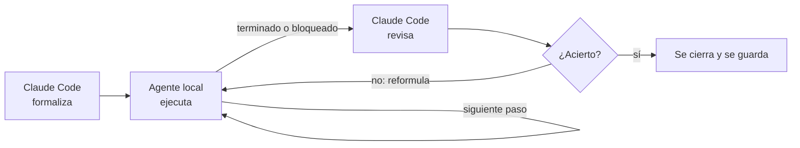
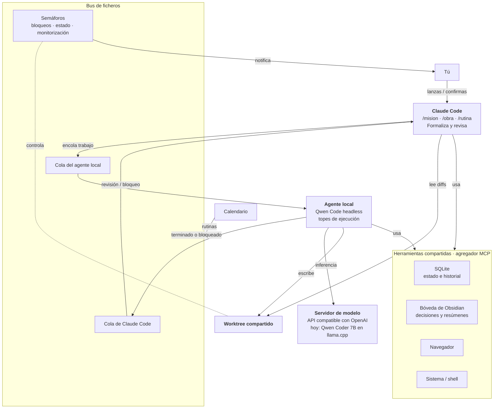

# Orquestador Claude Code + agente local

14 oct 2026 · Jesús · v2 (con respuestas a la primera ronda de preguntas)

## Visión

Una capa de orquestación **encima del asistente local de Arch** que reparte el trabajo entre dos agentes: Claude Code piensa, formaliza y revisa; un agente local (hoy Qwen Coder 7B) ejecuta. Todo trabajo sigue un flujo determinista, con colas y semáforos que lo controlan y lo monitorizan.

**Objetivos:** reducir el consumo de cuota de Claude y experimentar con sistemas multiagente.

**Principios**

- **Claude Code no hace tareas sencillas.** Sus modelos son más capaces y más caros: usarlos para trabajo mecánico es desperdiciar cuota. Claude Code solo formaliza, decide y revisa.
- **Un único punto de entrada.** El trabajo se lanza desde Claude Code (o por calendario en el caso de las rutinas). El agente local nunca arranca trabajo por su cuenta.
- **El modelo local es intercambiable.** Cambiar de modelo es cambiar una línea de configuración, sin tocar nada más.
- **Tú tienes la última palabra.** Nada vuelve a Claude Code tras un fallo sin tu confirmación, y tú decides cada cuántas fases revisa en las obras grandes.

## Roles

| Responsabilidad | Claude Code | Agente local |
| --- | --- | --- |
| Lanzar el trabajo | Sí (y el calendario, para rutinas) | Nunca por su cuenta |
| Definir qué se hace | Objetivo, flujo, plan o proceso | No |
| Ejecutar | Solo lo que exige criterio: diseño, arquitectura, depuración difícil | Todo lo que se puede describir en pasos verificables, incluido buscar, leer y resumir |
| Parar | Decide si se cierra o se reformula | Sale al terminar o al toparse con un límite |
| Revisar | Comprueba el resultado y su acierto | No |

**Regla de reparto:** si una tarea se puede escribir como pasos con un criterio de éxito comprobable, la hace el agente local, aunque Claude Code la hiciera más rápido. Claude Code tampoco debe leer el trabajo entero al revisar: el agente local le entrega un resumen estructurado y Claude Code solo abre el detalle que necesite.

## Modos de trabajo

| | `/mision` | `/obra` | `/rutina` |
| --- | --- | --- | --- |
| Para qué | Alcanzar un objetivo iterando | Implementar un plan | Repetir un proceso conocido |
| Claude Code formaliza | Objetivo, flujo iterativo y criterio de éxito | Plan, entero o por fases | El proceso, una sola vez |
| El agente local hace | Recorre el flujo en bucle | Implementa fase a fase | Ejecuta el proceso guardado |
| Se lanza desde | Claude Code | Claude Code | Claude Code o calendario |
| Vuelve a Claude Code | Al terminar o al quedar bloqueado | Al terminar, o cada N fases (obra mayor) | Solo si falla y tú lo confirmas |
| Se guarda | Flujo y resultado | Plan, fases y diffs | Definición versionada del proceso |

### `/mision`

- El agente local sale del bucle por dos puertas: **terminado** o **bloqueado**. En ambos casos Claude Code decide si se cierra o si reformula el flujo.
- Claude Code escribe un criterio de éxito comprobable (un comando que pasa, un fichero que existe). El agente local no se da el visto bueno a sí mismo.
- Topes duros por ejecución (turnos, tiempo y llamadas a herramientas) para que «bloqueado» llegue antes de dar vueltas sin avanzar.

### `/obra`

- **Obra menor:** plan sin fases o con pocas. Claude Code revisa al terminar.
- **Obra mayor** (el superplan): plan dividido en fases. Claude Code revisa cada N fases, y ese N lo fijas tú al crear la obra (por ejemplo `revisar_cada: 2`).
- Cada fase tiene su entregable y su criterio de aceptación. La revisión es sobre el diff de esas fases.

### `/rutina`

- Claude Code formaliza el proceso una vez; las ejecuciones siguientes lo reutilizan.
- Una rutina es un fichero versionado con entradas, pasos, criterio de éxito y salida esperada.
- Se lanza desde Claude Code o por calendario.
- **Si falla:**
    1. El sistema te notifica.
    2. Prepara un paquete de corrección para Claude Code, con la definición, la salida y el error.
    3. El paquete queda **en espera** hasta que lo confirmes. Antes puedes revisarlo y añadir contexto.
    4. Con tu confirmación, Claude Code corrige la definición y sube su versión.

Esto encaja con la regla que ya tenía el asistente de Arch: lo desatendido no muta nada, y todo lo que muta se encola como propuesta.

## Arquitectura

Los dos agentes trabajan sobre **el mismo worktree de git** y se comunican por un **bus de ficheros**. Cada agente tiene **su cola**, y unos **semáforos** controlan, gestionan y monitorizan cada tarea, entrada y salida. Claude Code entra por CLI, con una skill por comando.

### Piezas

| Pieza | Qué hace | Notas |
| --- | --- | --- |
| Skills de Claude Code | `/mision`, `/obra`, `/rutina` escriben la orden en la cola del agente local | Sin choque con los comandos integrados (`/goal`, `/plan`, `/tasks`, `/loop`, `/batch`) |
| Cola por agente | Entrada ordenada de trabajo para cada agente | Ficheros en una carpeta de estado, como en briefcode |
| Semáforos | Quién puede escribir en el worktree, estado de cada tarea, avisos | Imprescindibles al compartir worktree |
| Agente local | Qwen Code en modo headless (`qwen -p`) | Topes de turnos, tiempo y llamadas; salida JSON |
| Servidor de modelo | Cualquier API compatible con OpenAI | Cambiar de modelo = cambiar `base_url` y `model` en la configuración |
| Worktree compartido | Un único árbol de trabajo para ambos | El agente local escribe; Claude Code revisa el diff |
| Herramientas | SQLite, Obsidian, navegador y shell vía un agregador MCP | Ambos agentes pueden usar el navegador |
| Notificaciones | Avisos de fallos, bloqueos y paquetes en espera | Canal por definir (TUI, escritorio, voz) |

### Modelo intercambiable

El agente local nunca nombra al modelo en el código. [Qwen Code](https://qwenlm.github.io/qwen-code-docs/en/users/features/headless/) acepta cualquier proveedor compatible con OpenAI en `settings.json`, y el `llama-server` de llama.cpp expone esa API. Un fichero de configuración del orquestador fija el endpoint y el nombre del modelo, y todo lo demás lo lee de ahí.

## Encaje con el asistente de Arch

Este documento es el punto de partida para **retomar el rumbo**. El sistema va encima del asistente de Arch y reaprovecha sus piezas:

| Del asistente de Arch | En el orquestador |
| --- | --- |
| Modelo local en llama.cpp | Servidor de modelo del agente local |
| Bóveda de Obsidian compartida, con región propia del modelo local | Memoria de conocimiento de ambos agentes |
| Memoria SQLite para tareas | Estado de misiones, obras y rutinas |
| Tareas CRON programadas por ti | Disparo por calendario de las rutinas |
| Lo desatendido no muta; lo mutante se encola como propuesta | Fallos de rutina en espera de tu confirmación |
| Interfaces TUI y servicios al arranque | Monitor de colas y semáforos |
| Voz con sherpa-onnx | Canal posible de notificaciones (por decidir) |

**Choque a resolver:** en aquel diseño, el modelo local no tenía un rol agéntico y solo ejecutaba comandos con grandes sobrerraíles. Aquí implementa fases de una obra. Los topes, los semáforos y la revisión de Claude Code son esos sobrerraíles, pero conviene revisarlo con el repo delante.

## Riesgos

- **Capacidad de 7B.** Para implementar, las fases tienen que ser pequeñas y muy verificables. Como el modelo es intercambiable, se puede subir de tamaño sin rediseñar nada.
- **Worktree compartido.** Dos agentes escribiendo a la vez rompen el árbol. Los semáforos deben dar acceso de escritura exclusivo, al menos por fase.
- **Coste del traspaso.** Si Claude Code relee todo al revisar, se pierde el ahorro. El agente local entrega un resumen estructurado (estado, evidencia, diff y motivo).
- **Seguridad.** El modo de Qwen Code que aprueba todo [no activa ningún sandbox](https://qwenlm.github.io/qwen-code-docs/en/users/features/headless/). Conviene limitar la aprobación a ediciones dentro del worktree, o usar sandbox.

## Decisiones tomadas

| Tema | Decisión |
| --- | --- |
| Nombres | `/mision`, `/obra`, `/rutina` |
| Motivo | Reducir cuota de Claude y experimentar |
| Modelo local | Qwen Coder 7B por ahora; intercambiable sin cambios |
| Reparto | Claude Code no hace tareas sencillas |
| Relación con Arch | Capa encima del asistente de Arch |
| Disparo de rutinas | Claude Code o calendario |
| Fallo de rutina | Notificación y paquete para Claude Code, en espera de tu confirmación y contexto |
| Revisión de obras | Al terminar; en obra mayor, cada N fases según indiques |
| Comunicación | CLI más bus de ficheros, con worktree compartido, cola por agente y semáforos |
| Navegador | Disponible para ambos agentes |

## Preguntas abiertas

1. **Nombre del proyecto.** ¿Cómo se llama el sistema? También servirá de prefijo si se empaqueta como plugin (por ejemplo `/taller:obra`).
2. **Bloqueo del worktree.** ¿Exclusivo para todo el worktree mientras un agente escribe, o por fichero?
3. **Notificaciones.** ¿Por dónde te avisa: TUI, notificación de escritorio, voz o varias?
4. **Encaje con Arch.** Pendiente de revisar con el repo en Claude Code: qué piezas existen ya y cuáles faltan.

## Recursos

- [awesome-mcp-servers](https://github.com/punkpeye/awesome-mcp-servers): categorías *Knowledge & Memory*, *Databases*, *Version Control*, *Browser Automation*, *Command Line* y *Aggregators*.
- [agency-agents](https://github.com/msitarzewski/agency-agents): base para los prompts de cada rol, en particular Workflow Architect, Senior Project Manager, Minimal Change Engineer, Code Reviewer y Reality Checker. Mejor copiar y recortar que instalar divisiones enteras.
- Claude Code: [skills](https://code.claude.com/docs/en/skills) y [comandos integrados](https://code.claude.com/docs/en/commands).
- Qwen Code: [modo headless](https://qwenlm.github.io/qwen-code-docs/en/users/features/headless/).
